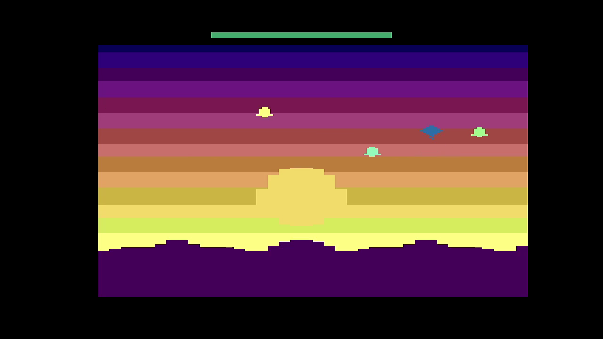
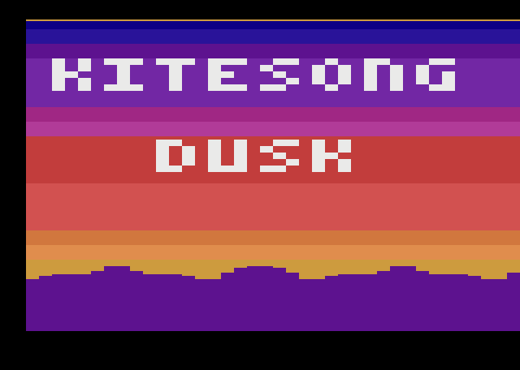
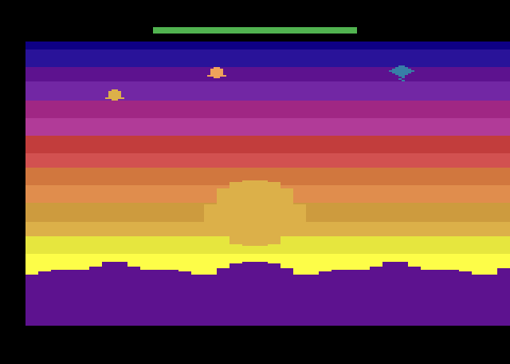
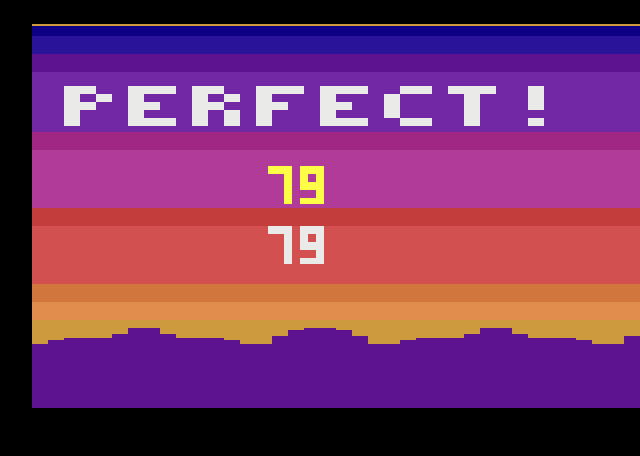
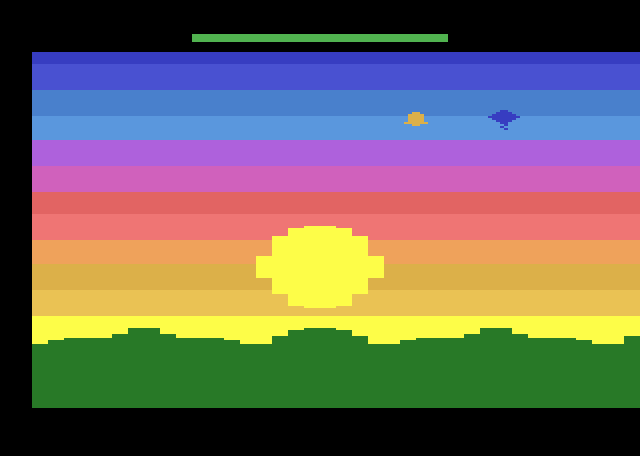

# KITESONG — a song you play by flying

An Atari 2600 rhythm flyer. Every note of the song is a chime on the wind, flying at the height
of its pitch; fly the kite through it and the note rings. The bass and drums always play, so the
music never stops, but the melody is yours: miss a chime and that note stays silent.



[Watch and listen: 80 seconds on FPGA hardware](docs/media/kitesong-pynq-z2.mp4) (the attract
demo flying Dusk, recorded from the PYNQ-Z2's HDMI output).

- **ROM:** [`release/kitesong.F8`](release/kitesong.F8) (8 KB, F8 bank switching, NTSC)
- **Songs:** six (Dusk, Night, Gale, Dawn, Drift, Tide) and Free Flight
- **Status:** playable. Tested on Stella (the bot) and on FPGA hardware through
  [retro-silicon](https://github.com/particlesector/retro-silicon)'s 2600 core; see [Testing](#testing).

## How to play

| Control | Action |
|---|---|
| Joystick up / down | Fly the kite; let go and it settles on the nearest lane |
| Joystick left / right, or Select | Choose a song on the title screen |
| Button, or Reset | Start the song |
| Button (Free Flight) | Play the note at the kite's height |
| Select (or Reset in Free Flight) | Back to the title |

- A chime reaches the kite exactly on its beat; be in its lane then and it rings.
- The **wind meter** at the top drops with every miss and refills with every catch. Run out of
  wind and the kite falls: try again.
- Catch every chime of a song and it's **PERFECT!**: the title screen shows a song's star.
- **Free Flight** has no chimes: fly anywhere over the band and press the button to play the
  note at the kite's height. Every note is in the same scale, so anything you play fits. Your
  notes drift away behind the kite as chimes.
- Leave the title alone for ten seconds and the game flies a song itself.

   

## The music

The TIA makes notes by dividing a 31.4 kHz clock by whole numbers, so most of a piano is out of
tune on it. Every song is in C major pentatonic on the notes the chip plays within 20 cents:

| Part | Channel | Waveform | Notes |
|---|---|---|---|
| Melody (the chimes) | 1 | pure tone | C4 D4 E4 A4, C5 D5 E5 G5 A5 C6 (ten lanes) |
| Bass | 0 | buzzy 4-bit poly | C2 F2 A2 Bb2; G3 on the pure tone |
| Snare | 0, between bass notes | noise | |

Songs are text in [`assets/songs.txt`](assets/songs.txt): bars of eighth notes over a chord,
compiled by `tools/build_data.py`, which refuses a note the TIA can't play in tune.

## Building

Needs cc65 (`ca65`, `ld65`) and Python 3.

```
make          # build/kitesong.F8
make test     # needs Pillow and a libretro Stella core (STELLA_CORE, default Debian's)
```

## How it works

- **Two banks.** Bank 1 has the frame loop, input and the three kernels; bank 0 the songs and
  the music driver, which once a frame times the song, plays the bass and drums, judges catches
  and misses, and builds the display list. They meet through a trampoline at `$FFE0`.
- **The sky** is ten bands of 14 lines, one a lane. A band's first line places player 1 for its
  chime, the second fine-moves it and sets its colour (each pitch its own) and its copies; up to
  three chimes share a band as player 1's copies when they're 1, 2 or 4 eighths apart. The
  background colour changes every line (the gradient), the sun is the reflected playfield, the
  kite is player 0 drawn by skip-draw. Every line strobes HMOVE, so the 8-pixel blank on the left
  is the same on every line.
- **Timing.** The wind moves 16 pixels an eighth note, whatever the tempo, so a chime is 16, 32 or
  64 pixels from its neighbours, the spacings player copies have.

## Testing

`tests/run_tests.py` runs on Stella's libretro core through `shared/tools/a2600_emu.py`:

- every song played to its end by a bot that flies to each chime's lane: it must be PERFECT,
  each caught chime ringing its own lane's note (each song's machine-checked solution);
- left alone, the kite runs out of wind and falls;
- Free Flight's button plays the kite's note and leaves its chime;
- the attract demo starts, flies its song perfectly and hands back to the title;
- no frame's logic ever outruns its VBLANK or overscan time.

On FPGA hardware, through retro-silicon's 2600 core: the title (frame 60) and the attract demo
(frame 1500, with its first 708,257 sound samples) match Stella's frame and sound CRCs on the
Tang Nano 20K, the Tang Console 138K and the PYNQ-Z2, and the video above is the PYNQ-Z2's HDMI.

Not verified: a real 2600; how the songs feel to a human player (only the bot has finished them);
emulators other than Stella.

Pitch and mockups: [docs/pitch/PITCH.md](docs/pitch/PITCH.md).
