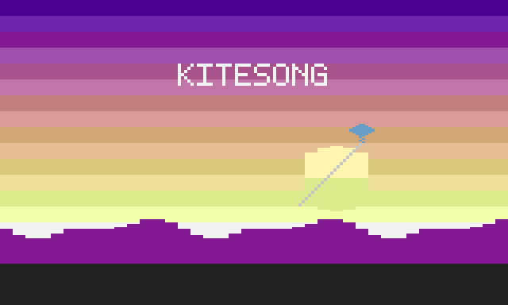
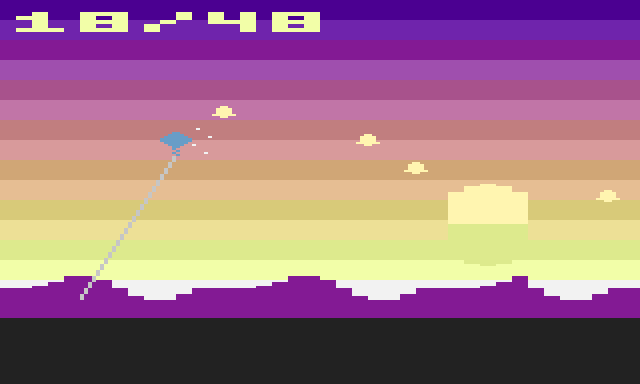
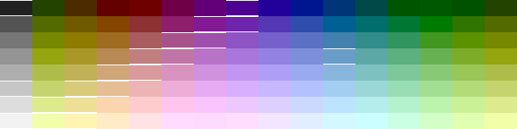

# KITESONG — a song you play by flying

*Pitch for an Atari 2600 game. Nothing is built yet: these are mockups and a
rendered theme, for a yes or a no.*

## The hook

**Every note of the song is a chime on the wind.** Fly your kite through it
and the note rings; miss it and that note stays silent. The bass and drums
never stop, so the music never breaks, but the melody is yours: a perfect
flight plays the whole tune, and a clumsy one plays it with holes.

Each chime flies at the height of its pitch, so the melody is drawn across
the sky as you hear it, and flying it is tracing its contour with the joystick.

Listen: [the theme, every chime caught](theme.mp3), and
[the same with four chimes missed](theme_missed.mp3).

## Genre

A rhythm flyer. One joystick, up and down; no button needed. A song lasts two
to three minutes; there are no lives and no game over, only how much of the
song you played (`18/48` chimes in the mockup's corner).

## Core rules

| Rule | Consequence |
|---|---|
| The wind carries the chimes right to left, in time with the song | A chime reaches the kite exactly when its note is due |
| A chime's height is its pitch | Rising tunes climb the sky, falling ones dive |
| Catching a chime plays its note on the melody channel | The player performs the melody |
| A missed chime is silent | You hear exactly how well you flew |
| Bass and drums always play | It's always music, even on a first try |

Songs (proposed): **Dusk** (this theme, gentle), **Night** (stars, faster,
bigger leaps), **Gale** (gusts nudge the kite; the left difficulty switch on A
turns them on for every song), **Dawn** (the finale). Catching every chime of a
song lights a star on the title screen.

## Art direction

A 2600 sunset: the sky is the background colour changed down the screen
(violet at the top to gold at the horizon), the sun and the hills are the
playfield, the kite is player 0 with its string drawn by missile 0 stepping a
pixel a line, the chimes are player 1 reused down the screen, and a caught
chime sparkles with the ball. One teal kite in a warm sky, so you always see
it first.

## The sound, on the TIA's two channels

The TIA plays notes by dividing a 31.4 kHz clock by whole numbers, so most of
a piano is out of tune. The theme uses only notes the chip plays within 17
cents:

| Part | Channel | Waveform (AUDC) | Notes |
|---|---|---|---|
| Melody | 1 | 4, pure tone | C5 D5 E5 G5 A5 C6 (C major pentatonic) |
| Bass | 0 | 1, buzzy 4-bit poly | C2 F2 A2 C3 (C, Am, F) |
| Snare | 0, between bass notes | 8, noise | — |

So every song is written in C major pentatonic over C, A minor and F, which
is also why a missed note never clashes.

## Proposed scope

- 8 KB cartridge (F8 bank switching): the kernel in one bank, the songs and
  sound driver in the other
- Four songs, a title screen with each song's stars, a results screen
- NTSC; joystick; difficulty switches as above
- Runs on Stella and on retro-silicon's 2600 core (all three FPGA boards)
- Tests: each song is played to the end by a bot that catches every chime
  (the song's "solution"), on Stella's libretro core, checking the music it
  hears

## Open questions

1. The name, and the concept: a rhythm flyer rather than a puzzle game.
2. No lives and no fail state (my choice, to keep the music going), or a gentle
   fail (the kite drops after N misses in a row)?
3. Four songs at 8 KB, or fewer at 4 KB (no bank switching)?
4. Original music by me in the TIA's pentatonic, or tunes you'd like to write?

## About these assets

Drawn and rendered by `tools/pitch/make_assets.py`. The pictures keep the
TIA's limits by construction (one background colour a line, a 40-bit
playfield in one colour, 8-pixel players, 1-pixel missiles and ball) with
colours from a simple NTSC model; they are mockups, not captures. The theme is
rendered from the TIA's audio clock and the dividers and polynomial counters
of the waveforms used, a note change a frame as a 2600 driver makes them; how
close it sounds to the real chip hasn't been checked.
