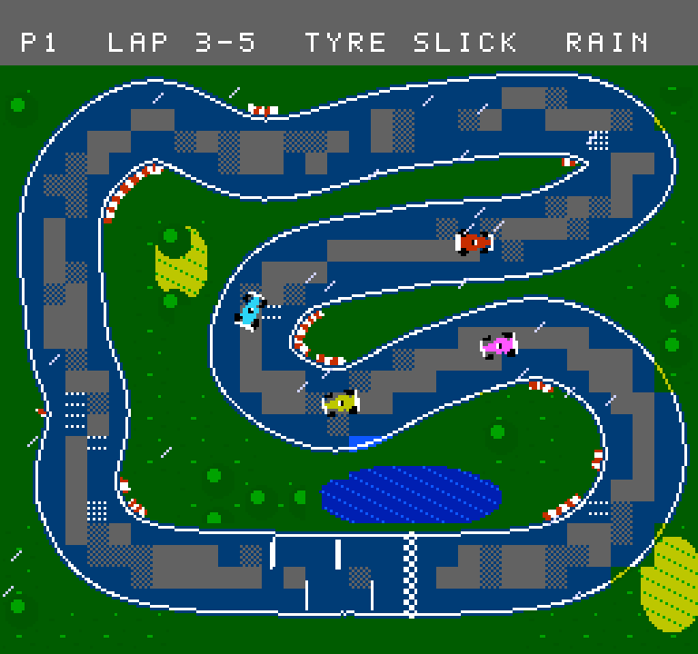
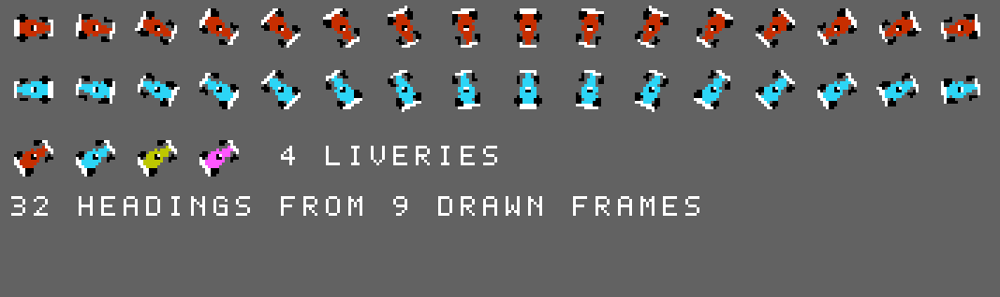

# Dev log 001: finding the idea

*13 November 2026. No game code yet. This entry covers the day the concept and first mock-ups were made.*

## The brief

The request was short: another NES game, inspired by Super Sprint, as detailed
and polished as we can make it, with no deadline. And keep a log of how it gets
built.

Super Sprint's appeal is easy to name. You see the whole circuit at once, the
cars are tiny, and several of you are fighting over the same corner. That part
we keep. The rule we set ourselves is that nothing else comes from it: no
layouts, no art, no sounds. The game needs an idea of its own.

## Looking for a hook

A racing game on one screen has a problem: the track never changes, so lap
five is lap one again. The ideas that survived were all about making the track
change during a race.

The one that stuck is from real motor racing. When rain stops, cars dry the
tarmac where they drive, and a "dry line" appears. On it there is grip. Off it
there is none. Drivers on dry-weather tyres tiptoe around a ribbon of pale
tarmac one car wide.

That gives a single-screen racer something new: **the track remembers where
cars have been.** It also gives the game its name.

It brings other decisions with it. If the surface matters, tyres matter, so
there are two kinds. If tyres matter, there is a reason to pit. If you can pit,
a forecast becomes worth reading. One idea produced most of the design.

## Can a NES draw it?

An idea is only useful if the machine can show it, so the first job was a
mock-up that obeys the console's rules. The NES background is a grid of 8x8
tiles, at most 256 different ones at a time, coloured in 16x16 blocks that each
choose one palette of four colours.

**Attempt one: sparkles.** Wet tarmac was the normal grey with white glints.
It kept the colours simple, and it did not read as wet at all. It looked like
gravel.

**Attempt two: dark tiles.** Wet tiles were redrawn in a dark blue-grey. Now
wet looked wet, but only tiles that are entirely road can be swapped, because
tiles on the track's edge also contain grass and white line. The result was a
grey rim around every dark patch. On a road three tiles wide, most of the
track was rim.

**Attempt three: turn it inside out.** The fix was to stop drawing the wet and
draw the dry. When rain starts, the game changes one palette colour and the
entire road goes dark at once: edges, kerbs and all, with no tile changes. The
tiles that cars have dried are then redrawn using a colour kept in reserve.
The thing the game redraws is the dry line itself, which is the thing the
player is looking for. It costs less and looks better.

The road also had to get wider, from 26 to 32 pixels. A line you can be on or
off needs room for both.

## The tile budget surprise

The mock-up tool counts how many different tiles a circuit needs. The first
count was 546, more than double the limit.

The curves were not the problem. The grass was. It had been textured with
random speckles, which made every grass tile on screen unique. Replacing the
noise with a small repeating pattern, and snapping trees to the grid, brought
the count to 339.

That is still over 256. Smooth curves cost tiles, and squaring them off would
lose the look. So each circuit will use two sets of tiles, with the console
switched from one to the other partway down the screen. TIDEBELL already does
exactly this at its waterline, so the technique is proven on the hardware we
test on.

## The cars

Thirty-two headings is a lot to draw by hand and keep consistent. Instead the
car is described once as a shape (body, wheels, wings, helmet) and a script
renders it at each angle. Only nine angles need storing; the rest are mirror
images.

## Where things stand

- A concept, a name and a pitch document.
- Mock-ups of one circuit, dry and wet, an animation of the line forming, and the car sprites.
- No game code. The pitch goes to Chris first.

## Open questions

- Does two-player belong in the first version?
- Can the hardware keep best lap times when switched off, or do we use codes?
- Music during a race, or engines and tyres only?
- The dry line is blocky. How smooth can it get within the tile budget?
