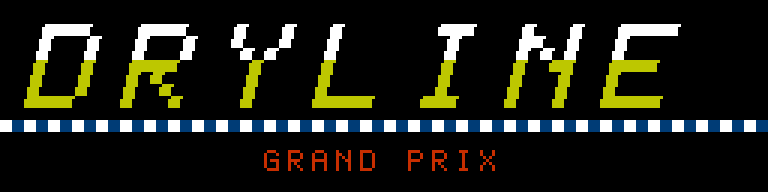
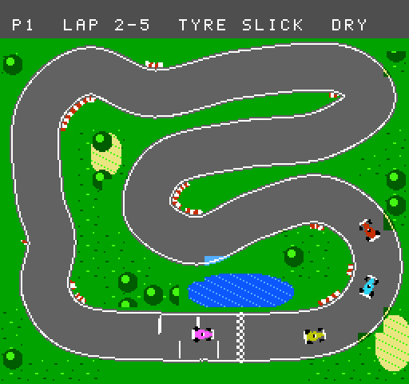
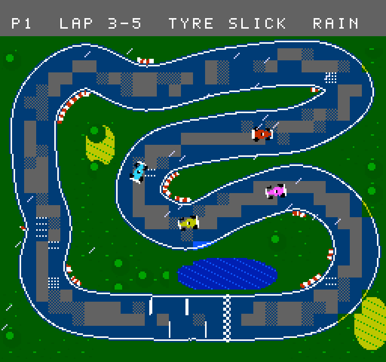
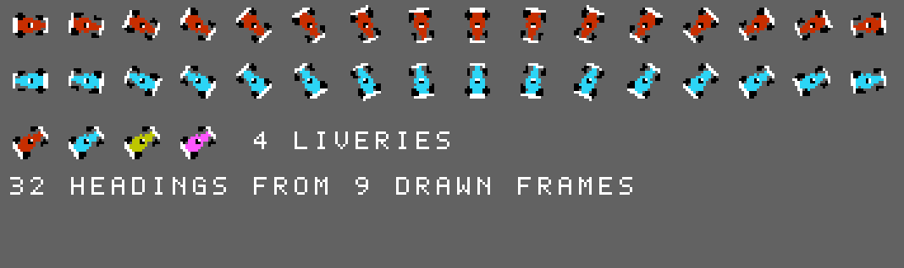
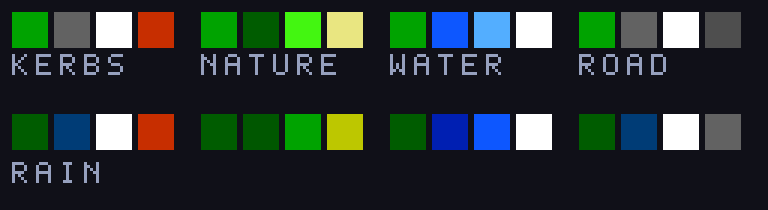

# DRYLINE Grand Prix

*Pitch for an original NES racing game. Status: concept and mock art only. No game code exists yet.*

## The hook

A single-screen, top-down grand prix where **the track remembers where the cars have driven.**

When the rain comes, the whole circuit goes dark and slippery. Every car that
passes dries the tarmac under its wheels, so lap by lap a pale **dry line**
appears. Stay on it and you have grip. Leave it to overtake and you are on the
wet. Nobody draws the line for you: the field makes it, and it moves if the
field drives differently.

## Where it comes from

You asked for a game inspired by Super Sprint. DRYLINE takes the genre from it:
a whole circuit on one screen, tiny cars, several racers at once. Everything
else is new: its own name, cars, drivers, circuits, art and music, and a
central idea (weather and the dry line) that the old game never had. No track
layouts, graphics or sounds are copied.

## What you do

- **Race** four cars on a circuit you can see all of, over a few short laps.
- **Read the sky.** The forecast in the HUD says when rain is due and when it will pass.
- **Choose tyres.** Slicks are fast on a dry line and treacherous off it. Wets are safe in the rain and slow, and wear out fast, on a dry track.
- **Pit.** A stop costs a few seconds and swaps tyres. Stopping a lap too early or too late is how races are lost.
- **Drive the line or gamble off it.** Overtaking in the wet means leaving the dry tarmac.

## Proposed contents

| | |
|---|---|
| Circuits | 8, each with its own layout, scenery and palette |
| Cars on track | 4: you and three rivals, or two players and two rivals |
| Modes | Championship (8 rounds, points, standings), Single Race, Time Trial, Two Player |
| Rivals | 7 named drivers with different strengths: late brakers, tyre savers, rain specialists |
| Handling | Momentum and slide, not rails: cars drift, and grip depends on surface, tyre and wear |
| Presentation | Title, driver select, circuit preview, starting lights, results, standings, podium, ending |

## The rival drivers

Each rival follows a racing line with a look-ahead to brake for corners, then
adjusts for what is in front of it:

- **Overtaking and defending.** A faster car picks a side; the car ahead may cover it.
- **Personality.** Per-driver numbers for braking distance, risk, consistency and wet-weather skill.
- **Mistakes.** Rivals run wide and spin, more often on worn tyres or off the dry line.
- **Strategy.** Each decides when to pit from the forecast and its tyre wear, and they do not all decide alike.

## Art

Circuits are drawn from smooth curves, not square blocks, with kerbs, gravel,
water and trees. Cars are open-wheel racers with 32 headings, rendered from one
shape so every angle is consistent.

## Sound

- **Engines** that rise and fall with speed, the player's loudest.
- **Tyres and weather:** skids, kerb rumble, rain, thunder, pit-stop wheel guns.
- **Music:** title, menus, circuit previews, results and podium, plus short stings for the start and the last lap.

## How it works on the hardware

- **The dry line** is stored per 8x8 tile in RAM. A handful of tiles change each frame, well inside what the NES can redraw.
- **Rain changes the palette, not the tiles.** The whole road goes dark with a few colour writes; dried tiles use a colour kept aside for them.
- **Smooth-curve circuits need more tiles than one bank holds.** The mock circuit uses 339 unique tiles against a limit of 256, so each circuit gets two tile banks, swapped mid-screen by the same scanline-interrupt technique as TIDEBELL's waterline.
- **Cartridge:** MMC3 again, with more ROM than TIDEBELL (about 128 KB program, 128 KB graphics).
- **Testing:** the rival drivers double as the test bot. Every circuit must be lapped by the AI on both tyre types, in the dry and the wet, on every build.

## About these mock-ups

Rendered by `tools/pitch/make_mock.py` under NES limits: 16x16 cells with one
4-colour palette each, 3-colour sprites, real NES palette values, and wetness
kept per tile as the game would. They are mock-ups, not captures from a ROM.
The dry line is blocky in this first pass; smoothing its edges is on the list.
