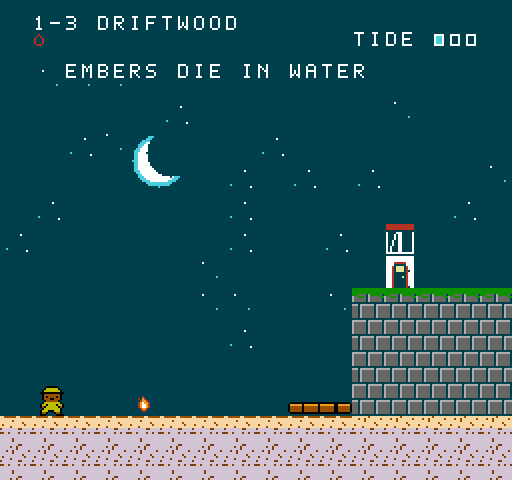
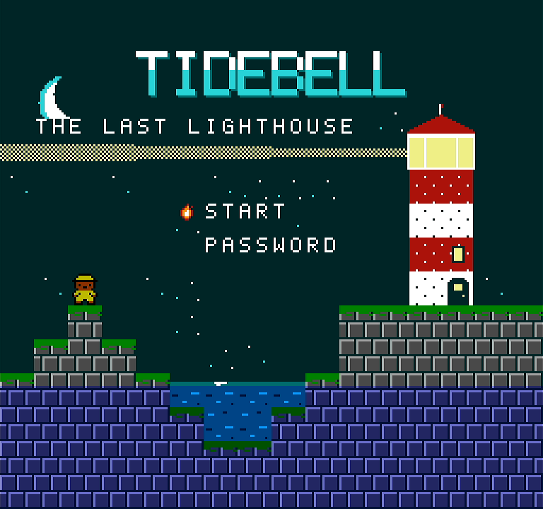
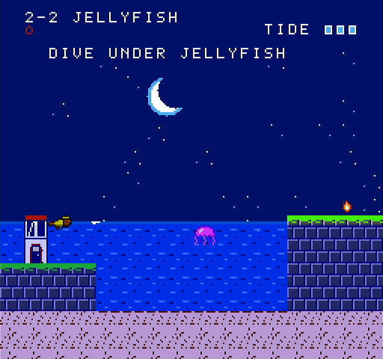
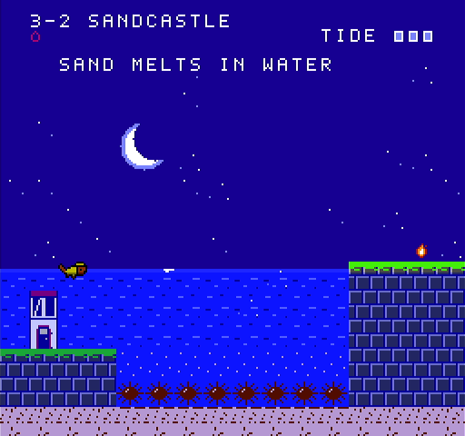
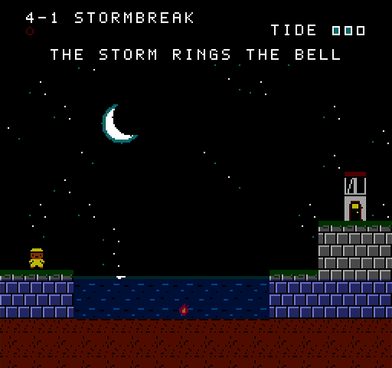
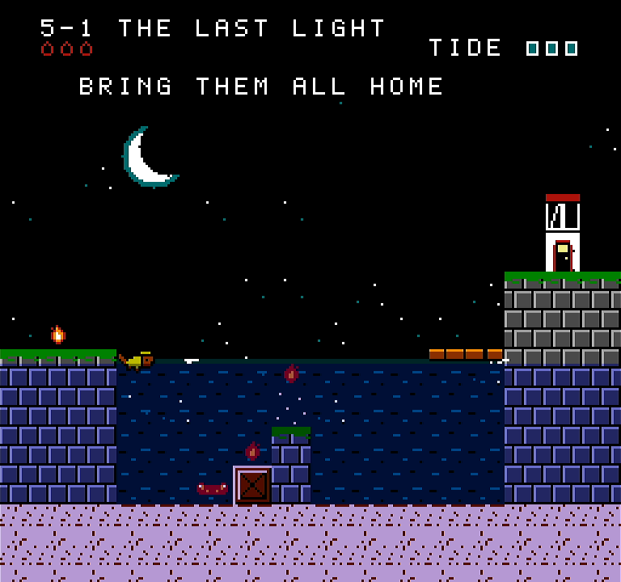

# TIDEBELL — a tale of the last lighthouse

A single-screen tide-puzzle platformer for the NES. You don't move through the
level, you move the sea.



- **ROM:** [`release/tidebell.nes`](release/tidebell.nes) (MMC3 / mapper 4, 32 KB PRG, 16 KB CHR, NTSC)
- **Size:** 33 rooms across four islands and a finale, about an hour for a first play
- **Status:** complete. Tested on Nestopia (the bot), MesenCE, and FPGA hardware through [retro-silicon](https://github.com/particlesector/retro-silicon)'s NES core; see [Testing](#testing).

## How to play

Pim the otter carries the Tidebell. Bring every ember in the room to the
beacon door to relight it.

| Button | Action |
|---|---|
| D-pad | Walk; swim in any direction when in water |
| A | Jump; at the water's surface, hop out |
| B | Ring the bell: tide rises one step |
| Down + B | Ring the bell: tide falls one step |
| Start | Pause (shows the room's code) |
| Select | Retry the room |

Rules of the sea:

- **Embers die in water.** If Pim goes under while carrying, they return to where they lay. Wading up to the waist is safe.
- **Embers at the door are safe for good.** You can deliver them one at a time.
- **Driftwood floats.** Stand on it and ring the bell to ride it up or down.
- **Crabs** are deadly on dry ground and fall asleep once water covers their feet.
- **Jellyfish** bob at the surface and sting swimmers; dive under them. Beached, they are harmless.
- **Urchins** always hurt. Jump a single one, swim over a row.
- **Coral** is solid only under water. **Sandcastles** are solid only in air.
- **Storms** (island 4) ring the bell for you: low, mid, high, mid, and round again.

Room codes are listed in [docs/PASSWORDS.md](docs/PASSWORDS.md).

## Building

Needs [cc65](https://cc65.github.io/) and Python 3.

```
make          # build/tidebell.nes
make test     # replay every room and run the flow checks (see below)
```

| Path | What it is |
|---|---|
| `src/main.s` | Game: reset, NMI/IRQ, rooms, physics, objects, screens |
| `src/sound.s` | 2A03 music and sound-effect driver |
| `assets/levels.txt` | All rooms as text maps, each with its tested solution |
| `assets/music.txt` | Soundtrack and effects in a small note language |
| `tools/build_chr.py` | Draws every tile and sprite and packs the CHR ROM |
| `tools/build_levels.py`, `tools/build_music.py` | Compile the assets to assembly |
| `tests/` | Emulator-driven tests |

## How the water works

The waterline is a raster split, not drawn tiles. An MMC3 scanline interrupt
fires just above the waterline; the handler waits for horizontal blank, swaps
the background pattern bank so sky tiles become water tiles, and two scanlines
later turns on the PPU's blue emphasis bit to tint everything below, sprites
included. The tide can sit on any scanline and costs no VRAM writes.

The handler is cycle-timed (`irq` in `src/main.s`). If a console or core
shows a flickering pixel row at the surface, the two delay constants there are
the place to adjust.

## Testing

`make test` needs Pillow, numpy and the Nestopia libretro core
(`apt install libretro-nestopia`; set `NES_CORE` if it lives elsewhere). It:

- replays the `solve:` line of all 33 rooms with a bot that reads game RAM, so every room is proven clearable;
- checks menus, codes, pause, death, retry, the storm cycle and the ending;
- checks the waterline for torn scanlines and the title theme for pitch.

Not covered: an original NES console and cartridge.

### On FPGA hardware (retro-silicon)

TIDEBELL runs on [retro-silicon](https://github.com/particlesector/retro-silicon)'s NES core, which is checked frame for frame against MesenCE. Tested Nov 12, 2026, at retro-silicon 51c6577:

- **Builds reproducibly:** `make` with cc65 2.19 gives a ROM byte-for-byte identical to `release/tidebell.nes` (SHA-256 `22058c91…a758b9`).
- **Matches MesenCE exactly:** the title screen at frame 300, and room 1-1 at frame 1200 after pressing Start twice, by a CRC-32 of every pixel's palette value, on the Tang Nano 20K (where the 16 KB of CHR ROM is read from the FPGA's SDRAM) as in MesenCE. That includes the waterline's raster split and blue emphasis.
- **Keeps full speed:** on the Tang Nano 20K, 18 minutes of play held 60 frames a second, with 2,400 to 3,500 clocks of memory waits a frame against 17,471 to spare.
- **Played:** Chris played it on the Tang Nano 20K with a USB gamepad over HDMI: "it looks and sounds great". The PYNQ-Z2 captures below show a clean waterline, with no torn row, and sprites in the water tinted with it.

Captured from the PYNQ-Z2's HDMI output at 720p (the 256x240 picture scaled 3x), each room entered by its code with two rings of the bell:

| | |
|---|---|
|  |  |
|  |  |
|  | |

Recorded from the same HDMI output, 30 seconds each: [the title theme](docs/media/retro-silicon/title_theme.mp3) and [room 1-1](docs/media/retro-silicon/room_1-1.mp3).
