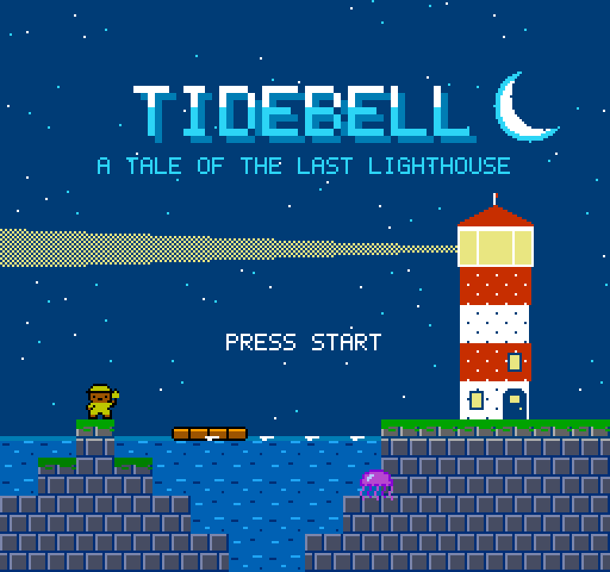
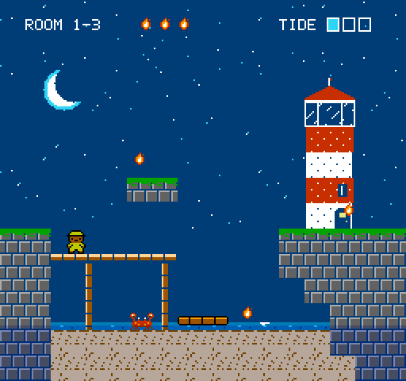
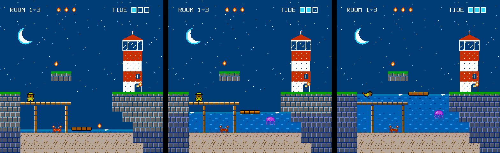
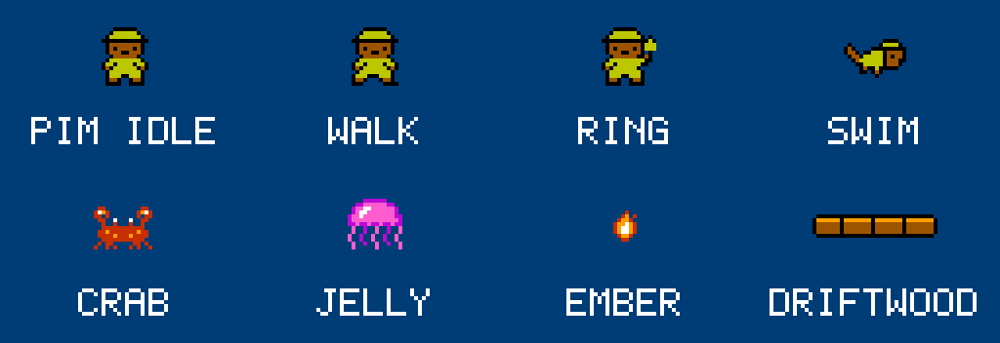
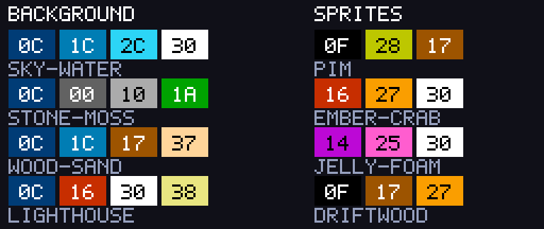
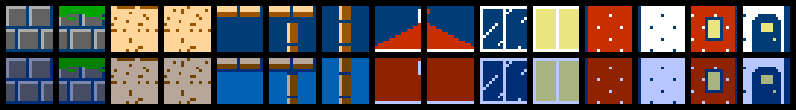

# TIDEBELL — a tale of the last lighthouse

*The original pitch, kept for reference. The game has since been built; see the [README](../../README.md). Some details changed along the way (sluice gates became coral and sandcastles).*

## The hook

You don't move through the level. **You move the sea.**

Pim, a small otter in a yellow raincoat, carries the Tidebell. Ring it and the
whole ocean rises or falls one step. Every room is a single-screen tide puzzle:
the same 256×240 pixels are three different levels depending on where the
waterline sits.

## Genre

Single-screen puzzle-platformer. Short rooms, no timer, instant retry.

## Core rules

| Rule | Consequence |
|---|---|
| The bell sets the tide to low / mid / high | One room = three layouts |
| Pim walks and jumps on land, swims freely in water | Water is a ladder you can summon |
| A carried ember goes out if Pim gets wet | Getting there is easy; getting back *dry* is the puzzle |
| Driftwood floats at the waterline | Rafts are elevators and bridges |
| Crabs walk the seabed, jellyfish rise with the water | Raising the tide moves the hazards too |

Collect every ember in a room, carry them to the lighthouse door, move on.
Relight all four lighthouses to finish the game.

## Art direction

Moonlit maritime storybook: navy night sky, red-and-white lighthouses, one
bright yellow raincoat so the hero is always the first thing you see.

## How the water works on real hardware

The waterline is a mid-frame raster split, not drawn tiles:

1. An MMC3 scanline IRQ fires at the waterline.
2. The handler swaps the background CHR bank, so "empty sky" tiles become
   "water" tiles without touching the nametable.
3. Two scanlines later it turns on the PPU's blue colour-emphasis bit, tinting
   everything below — background and sprites — while leaving a bright
   surface line.

So the tide can sit on any scanline and move smoothly at zero VRAM cost.

## Proposed scope

- 4 islands × 8 rooms + a final lighthouse climb (33 rooms)
- New element per island: driftwood → jellyfish → sluice gates → storm (tide moves on its own)
- Title, island map, ending; password continue
- Original soundtrack and SFX on the 2A03 (custom sound driver)
- NTSC, standard controller, runs on emulators and flashcarts

## About these assets

Rendered by `tools/pitch/make_assets.py`, which enforces NES limits by
construction: 16×16 attribute cells with one 4-colour palette each, 3-colour
sprites, 2C02 palette indices, and under eight sprites per scanline. They are
mockups, not emulator captures, and the art is first-pass.
